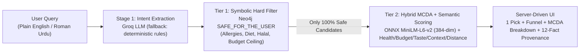
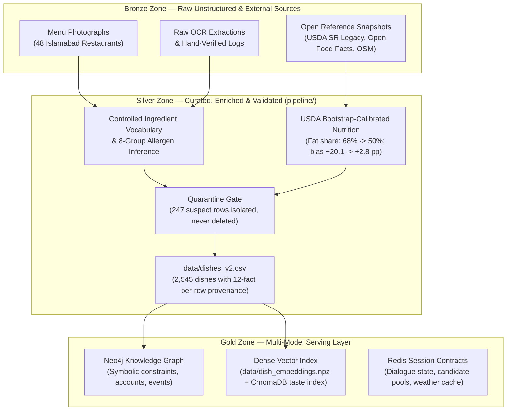

# Methodology, Architectural Justifications & Viva Defense Reference

This document provides the formal mathematical, architectural, and methodological justifications for Mood4Food's design decisions, written for both the final-year project report and the oral defense panel.

---

## 1. Why Nash Equilibrium Was Replaced by Confidence-Weighted MCDA

### 1.1 Mathematical Invalidity of Nash Equilibrium Here

An early project proposal framed Tier 2 ranking as a "Nash Equilibrium debate loop" between Health, Budget, and Taste agents. During implementation and verification, that framing was formally rejected because single-user food recommendation violates the structural axioms of a non-cooperative game $\mathcal{G} = (N, \{S_i\}, \{u_i\})$:

1. **No independent strategic players:** In a Nash Equilibrium, each player $i \in N$ independently chooses a strategy $s_i^* \in S_i$ that is a best response to the other players' strategies:
   $$u_i(s_i^*, s_{-i}^*) \ge u_i(s_i, s_{-i}^*) \quad \forall s_i \in S_i.$$
   In dish recommendation, "Health", "Budget", and "Taste" are **evaluation criteria of a single decision-maker**, not autonomous strategic agents with conflicting private payoff matrices. A dish's calorie count does not choose a strategy in response to its price.
2. **No meaningful strategy space or payoff matrix:** The decision variable is a single discrete choice $d \in \mathcal{D}_{\text{safe}}$ from the set of dishes that survive hard constraints. Treating attributes of $d$ as "players" forces artificial payoff functions with no game-theoretic interpretation.
3. **Inefficiency and non-uniqueness:** Non-cooperative Nash Equilibria are not guaranteed to be unique or Pareto-efficient (as in the Prisoner's Dilemma). A recommender system, by contrast, must select a **Pareto-efficient** dish that maximizes the user's stated and learned preferences.

### 1.2 The Valid Replacement: Confidence-Weighted Multi-Criteria Decision Analysis (MCDA)

Mood4Food replaces the invalid game-theoretic framing with **Confidence-Weighted Multi-Criteria Decision Analysis (MCDA)** incorporating **Bayesian-style shrinkage toward a neutral prior** ($u_0 = 0.5$) to handle real-world data uncertainty (OCR menus, estimated nutrition, inferred taste profiles):

$$U_{\text{total}}(d) = \left(\frac{\sum_{k \in \mathcal{A}(d)} w_k \cdot \big[c_k(d)\,u_k(d) + (1 - c_k(d))\,u_0\big]}{\sum_{k \in \mathcal{A}(d)} w_k}\right) \cdot \eta(d) + \Delta_{\text{peer}}(d)$$

where:
- $\mathcal{A}(d)$ is the set of **applicable** criteria for dish $d$ and the current request (`health`, `budget`, `taste`, `context`, `semantic`, `distance`). Criteria with no basis sit out (`applies = False`) rather than fabricating scores (e.g., `taste` sits out for a guest with no craving and no taste history; `distance` sits out when no location is set).
- $u_k(d) \in [0, 1]$ is the criterion-specific utility function.
- $c_k(d) \in [0, 1]$ is the **data confidence** of criterion $k$ for dish $d$, derived directly from data provenance (`price_status`, `nutrition_confidence`, `taste_source`, `location_precision`, `review_status`).
- $u_0 = 0.5$ (`NEUTRAL_UTILITY`) is the shrinkage prior:
  - When $c_k(d) = 1$, the term contributes its full utility $u_k(d)$.
  - When $c_k(d) = 0$ (missing data), the term shrinks to $0.5$ — neither unfairly eliminating a dish (as zero-imputation would) nor giving it a free pass over verified dishes (as dropping the term would).
- $\eta(d) \in \{0.7, 0.8, 0.9, 1.0\}$ is the **novelty decay multiplier** penalizing recently rejected ($0.7$) or recently recommended ($0.8$ within 3 days, $0.9$ within 7 days) dishes.
- $\Delta_{\text{peer}}(d) = (1 - U_{\text{base}}(d)) \cdot 0.15 \cdot \min(1, p_d / 3)$ is an **upward-only collaborative peer pull** from anonymous users with cosine-similar taste vectors ($\ge 0.9$ in ChromaDB), saturating at 3 approvals.

### 1.3 Why This Is Not a "Basic Average"

A plain unweighted average $\frac{1}{K}\sum u_k$ fails in five concrete ways that Mood4Food's model explicitly solves:

| Failure of a basic average | How Mood4Food's MCDA model solves it |
|---|---|
| Missing nutrition/taste data either scores `0` (eliminating valid dishes) or is dropped (inflating unverified dishes). | **Confidence-weighted shrinkage** pulls uncertain terms toward $u_0 = 0.5$ in proportion to $1 - c_k(d)$. |
| Excess fat hides behind two healthy macros (e.g., a 44%-fat dessert scoring 0.81). | **Asymmetric AMDR penalty**: the worst macro *over* its Acceptable Macronutrient Distribution Range carries 50% of the balanced health score on its own (`WORST_MACRO_SHARE = 0.5`), while low-carb dishes are not penalized as unhealthy. |
| Cosine similarity on flavour vectors scores an intensely sweet dessert and a barely sweet side identically (`0.9234`). | **Intensity-aware L1 weighted distance** $u_{\text{taste}} = 1 - \frac{\sum_j \alpha_j |d_j - q_j|}{\sum_j \alpha_j}$ with $4\times$ weight on explicitly craved dimensions (`CRAVING_IMPORTANCE = 4.0`). |
| Flat budget bands make user sliders unresponsive (every dish below median ties at 1.0). | **Continuous band-to-rank blending**: as the budget slider moves past $1/3$, the budget utility smoothly mixes from a target band into empirical price-rank percentile. |
| Asking fixed survey questions wastes turns when the answer cannot change the winner. | **Counterfactual question selection** (`dialogue/questions.py`): simulates each candidate answer over the top 150 dishes and asks a question only if at least 50% of answers change the winning dish (`ASK_THRESHOLD = 0.5`), capped at 2 questions. |

---

## 2. Justification of Weight Assignments and Constants

Every constant in [tier_2/scoring.py](file:///d:/OFFICE%20WORK/FIPE/Code/MVP/tier_2/scoring.py) is named, inspectable, and either derived from domain constraints, empirical calibration, or dynamically overridden by the user:

| Constant / Weight | Value | Justification |
|---|---|---|
| Core weights $(w_h, w_b, w_t)$ | Normalized to sum to `1.0` (default `1/3` each; overridden by sliders, persona, query words, or learned weights) | User-controlled primary trade-off simplex. Query words shift defaults smoothly (`"cheap"` or `"healthy"` → `0.60`; both → `0.40` each; `"fancy"` → budget `0.15`). Moving any slider overrides defaults immediately. |
| `SEMANTIC_WEIGHT` | `0.25` | Sits alongside the `1.0` core simplex (~20% share when active). Large enough that contextual queries (*"warm comfort food for a rainy evening"*) lift contextually matched dishes to #1, while small enough that dragging Health/Budget/Taste sliders still dominates. |
| `SEMANTIC_CONFIDENCE` | `0.85` | Dense embeddings are automated semantic estimates, never 1.0 human ground truth; keeping $c < 1$ applies honest shrinkage consistent with the rest of the model. |
| `DISTANCE_WEIGHT` | `0.15` | Tier 1 (`api/location.py`) already prunes restaurants beyond `10 km` when closer options match. Because surviving restaurants are already nearby, a larger distance weight would add a near-constant offset to every dish and mute the user's three sliders. Linearly decays from `1.0` at `≤ 3 km` to `0.0` at `12 km` (matching Islamabad's sector geometry). |
| `CONTEXT_WEIGHT` / `CONTEXT_WEIGHT_EXPLICIT` | `0.10` / `0.30` | Implicit clock/weather signals (e.g., hot afternoon >32°C, cold evening <12°C, late night) are weak nudges (`0.10`) so they never hijack an explicit preference. When the user explicitly names a meal or asks for something *"filling"* (`0.30`), context becomes a primary tie-breaker. |
| `CRAVING_IMPORTANCE` | `4.0` | An explicitly craved flavour (*"something spicy"*) must outweigh the 5 unmentioned dimensions combined; `4.0` gives the craved dimension 44% of total taste weight against 5 baseline dimensions (`4 / (4 + 5)`), preventing unmentioned dimensions from drowning out the craving. |
| `NEUTRAL_UTILITY` | `0.50` | Exact midpoint of $[0, 1]$: maximum-entropy neutral prior for missing data. |
| `PEER_PULL` / `PEER_SATURATION` | `0.15` / `3` | Collaborative signal closes at most 15% of the remaining gap to `1.0`, saturating at 3 similar-taste approvals. Upward-only so cold-start or niche dishes are never penalized for having few users. |
| `NOVELTY` multipliers | `0.7` (rejected), `0.8` (≤3d), `0.9` (≤7d) | Strong enough to prevent recommending the same dish twice in a row while still allowing an overwhelmingly superior match to recover after a week. |
| Provenance confidences | Price: `1.0 / 0.9 / 0.6`; Nutrition: `1.0 / 0.7 / 0.4`; Taste: `0.8 / 0.5 / 0.4 / 0.25`; Auto-imported: `× 0.85` | Directly encodes data lineage: human-verified menu prices carry `1.0`, unverified OCR prices `0.6`; taste values from source templates carry `0.8` (not `1.0`, since no human tasted the dish), down to `0.25` for global priors. |

---

## 3. Hybrid Semantic–Symbolic Context Search (Moving Beyond Keyword Matching)

### 3.1 Why Neither Pure Keyword Search nor Pure Vector/LLM Search Is Sufficient

- **Pure keyword matching** fails on contextual, occasion-based, and colloquial queries where the user's words do not appear in the dish name (e.g., *"warm comfort food for a rainy evening"*, *"light healthy office lunch"*, *"heavy desi breakfast nashta"*).
- **Pure vector/LLM search** is unsafe for food recommendation: dense embeddings have poor negation and hard-constraint fidelity (*"peanut-free"* or *"no nuts"* sits close to *"peanut"* in embedding space, risking anaphylaxis).

### 3.2 Mood4Food's Two-Tier Neuro-Symbolic Architecture

- **Tier 1 (Symbolic Hard Safety):** One Neo4j Cypher query (`SAFE_FOR_THE_USER`) removes every dish that violates allergies, diet, halal, or budget ceilings — and withholds dishes with unknown allergens whenever an allergen is excluded. Semantic search **never** overrides Tier 1.
- **Tier 2 (Dense Contextual Retrieval):** `pipeline/build_embeddings.py` embeds all 2,545 dishes into a compact **1.74 MB** `float16` vector index (`data/dish_embeddings.npz`) using **`ONNXMiniLM_L6_V2`** (384-dim sentence embeddings on ONNX Runtime — zero PyTorch, ~80 MB RAM, compatible with Render's 512 MB free tier). Each dish document encodes its name, cuisine description, ingredients, sensory flavour profile, nutrition/protein band, sharing size, and weather/occasion context.
- **Honest Calibration:** Raw cosine similarities are mapped through fixed calibrated bounds (`[0.15, 0.62]` → `[0, 1]`) rather than per-query min-max normalization, ensuring out-of-domain queries cannot artificially inflate an unrelated dish to 100%.
- **Latency:** ~86–108 ms per new query on CPU, and sub-millisecond on cached refinements and dialogue question probes.

---

## 4. The Data Lakehouse (Medallion) Architecture

Mood4Food's offline and online data infrastructure implements the **Medallion Data Lakehouse** pattern (Bronze → Silver → Gold) adapted for zero-cost open infrastructure:

- **Why Lakehouse rather than a single SQL table:** Menu data arrives as unstructured photographs and noisy OCR text (Bronze), requires repeatable, auditable enrichment and quarantine with per-field lineage (Silver), and must be queried simultaneously as a **relational/constraint graph** (Neo4j), a **semantic vector space** (MiniLM embeddings + ChromaDB), and **low-latency session state** (Redis) in the Gold serving layer.
- **Data Governance:** Raw data and derived datasets (`data/`, `data_review/`, `handoff_output/`) remain git-ignored to respect ODbL / open-data attribution obligations, while every served dish exposes its full 12-fact provenance dossier on screen (*"How we know this dish"*).

---

## 5. Justification for Representative Stock Imagery

### 5.1 Legal and Ethical Rationale

Mood4Food deliberately does **not** scrape dish photographs from Foodpanda, Google Maps, Instagram, or Facebook:
- Automated scraping of delivery platforms violates Terms of Service and intellectual property rights over commercial restaurant photography.
- Menu photographs collected by the team show printed menu text (names and prices), not individual plated dishes.
- Using **open-license Unsplash food photography**, explicitly labelled `"Representative image"` on screen, is both legally compliant and transparent to the user.

### 5.2 Dish-Specific Taxonomy Overhaul

Earlier versions relied heavily on broad cuisine fallbacks (60.3% of recommendable dishes fell back to a single cuisine photo, putting noodles on dumplings/fried rice and burgers on wings/fries). The upgraded mapper in [tier_1/symbolic_anchoring.py](file:///d:/OFFICE%20WORK/FIPE/Code/MVP/tier_1/symbolic_anchoring.py#L435-L580):
- Uses **whole-word regex boundaries** (preventing substring collisions such as `"platter"` matching `"latte"` or `"steak"` matching `"tea"`).
- Matches **compound and specific dish classes first** (e.g., `"spring roll"`, `"sushi roll"`, `"paratha roll"`, `"fish cake"`, `"chicken manchurian with rice"` resolve to their primary dish rather than a secondary word).
- Expands coverage to **27+ HTTP-verified dish classes** (biryani, fried rice, dumplings, wings, sandwich, grilled fish/seafood, fries, hummus/meze, Asian stir-fry, omelette/breakfast, tacos, sushi, roast chicken, samosa, pasta, soup, salad, kebab, curry, pizza, burger, etc.).
- **Honest omission:** Mixed categories (`cafe_bakery`, `other`) deliberately have **no fallback photo** — showing no image is more honest than showing the wrong dish.
- **Measured impact across all 1,985 recommendable dishes:** Dish-specific matches increased from **28.8% → 68.4%** (+39.6 pp), and generic category fallbacks dropped from **60.3% → 24.5%**.

---

## 6. Cross-Platform Mobile Architecture (Capacitor)

To deliver a native mobile experience without duplicating UI logic across three codebases, Mood4Food packages its React + Vite frontend using **Capacitor** (`pk.mood4food.app`):
- **Android (built & ready):** Native Gradle project (`frontend/android/`, `minSdk 24` / Android 7.0+, `targetSdk 36`) with automated GitHub Actions APK compilation (`.github/workflows/android-apk.yml`).
- **Native capabilities:**
  - `CapacitorHttp` + `CapacitorCookies` route API requests through Android's native HTTP stack, preserving `httpOnly` `SameSite=lax` session and authentication cookies without weakening backend security.
  - `@capacitor/geolocation` provides native device GPS for distance-based restaurant filtering (`≤ 10 km` radius).
- **iOS readiness:** Because the app is built on standard Capacitor plugins (`@capacitor/core`, `@capacitor/geolocation`), adding the native iOS Xcode target requires only `npx cap add ios` on a macOS build host — zero UI or API rewrite.

---

## 7. Foundational Groundwork & Literature Positioning

Mood4Food builds on four established research areas:
1. **Multi-Criteria Decision Analysis (MCDA) & Utility Theory** (Keeney & Raiffa, 1976; Figueira et al., 2005): Formal additive value functions over heterogeneous objectives (health, cost, taste, distance) with explicit preference weights.
2. **Uncertainty-Aware Recommendation & Shrinkage Estimation** (James–Stein / Bayesian shrinkage toward a neutral prior): Discounting noisy or imputed feature estimates proportionally to provenance confidence so missing data does not distort rankings.
3. **Neuro-Symbolic AI for Safety-Critical Filtering**: Combining neural language/semantic understanding (LLM intent parsing + dense MiniLM embeddings) with deterministic symbolic constraint satisfaction (Neo4j Cypher predicates) so statistical models never override hard dietary/allergy safety rules.
4. **Critique-Based Conversational Recommender Systems** (Burke, 2002; McGinty & Smyth, 2006; Jannach et al., 2021): Bounded mixed-initiative dialogue (at most 2 high-value counterfactual questions) followed by unit-critique refinements (*cheaper, lighter, spicier, milder, more filling, something different*) operating over the held candidate pool.

**Existing empirical verification in the repository:**
- **530+ automated tests** (`pytest`), including candidate contract guards, photo regression tests, semantic search tests, server-driven UI tests, and live browser tests.
- **23-query Golden Set** (`scripts/golden_set.py`): Safety **36/36**, Relevance **29/29**, Plausibility **92/92**.
- **USDA Nutrition Calibration** (`scripts/calibrate_nutrition.py`): 113 local dishes matched against 28 USDA whole-measured restaurant dishes, validated with 2,000 bootstrap resamples (reducing fat-share bias from **+20.1 pp → +2.8 pp**).

---

## 8. 60-Second Spoken Defense Answers (Viva Cheat-Sheet)

- **"Why did you replace Nash Equilibrium?"**
  > *"Nash Equilibrium models independent rational players choosing best-response strategies against each other. In food recommendation, health, budget, and taste aren't strategic opponents — they're criteria of one user's preference ordering, and a Nash equilibrium can even be Pareto-dominated. Replacing it with confidence-weighted MCDA is mathematically valid, guarantees Pareto-efficient ranking, and lets us shrink uncertain data toward a neutral 0.5 prior."*

- **"Aren't you just using basic averages?"**
  > *"No — if you open 'The scores' on any dish, you can see the exact formula: every term is weighted by user-controlled or learned weights, multiplied by its provenance confidence, and shrunk toward 50 when uncertain. Inside those terms we use asymmetric AMDR macro penalties so high fat can't hide behind carbs, L1 intensity-aware flavour distance instead of cosine, continuous band-to-rank budget blending, novelty decay, ChromaDB peer pull, and 384-dim ONNX semantic similarity."*

- **"Why are you using keyword matching instead of context-based search?"**
  > *"We upgraded to hybrid neuro-symbolic retrieval: Tier 1 Neo4j symbolic rules remain the strict hard safety filter because embeddings cannot safely enforce 'no peanuts' or 'halal', while Tier 2 now embeds all 2,545 dishes with ONNX MiniLM-L6-v2 over their full culinary, nutritional, and occasion context. A query like 'warm comfort food for a rainy evening' retrieves soups in ~90 ms with zero keyword overlap."*

- **"Where is your Data Lake concept?"**
  > *"Our pipeline implements a three-zone Medallion Lakehouse: Bronze holds raw menu photographs, OCR logs, and USDA/Open Food Facts snapshots; Silver (`pipeline/` → `dishes_v2.csv`) performs vocabulary normalization, allergen inference, USDA bootstrap calibration, and isolates 247 suspect rows into quarantine with 12-fact per-row provenance; Gold serves the curated data simultaneously through Neo4j, our 384-dim vector index, and Redis session contracts."*

- **"Why stock images, and why did they mismatch?"**
  > *"We refuse to scrape Foodpanda or Google Maps photos for legal and copyright reasons, so we use open-license Unsplash photos explicitly labelled 'Representative image'. Previously 60% of dishes fell back to generic cuisine photos; we audited all 1,985 recommendable dishes, added 27+ verified dish-specific classes with specificity-ordered whole-word matching, raised dish-specific accuracy from 28.8% to 68.4%, and intentionally omit photos for mixed categories rather than showing the wrong dish."*
